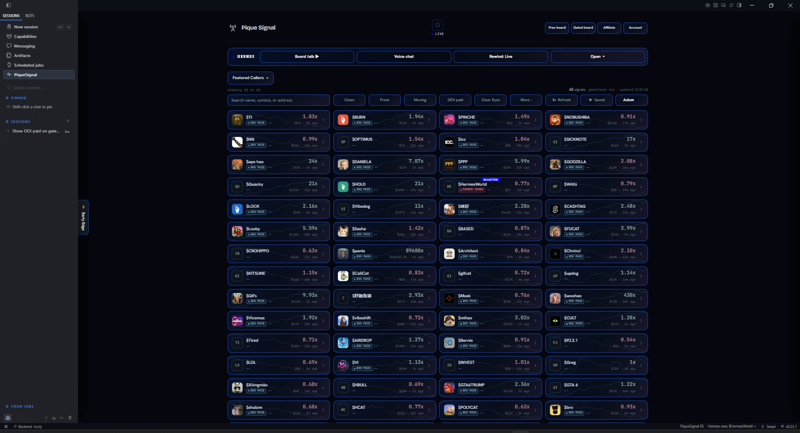
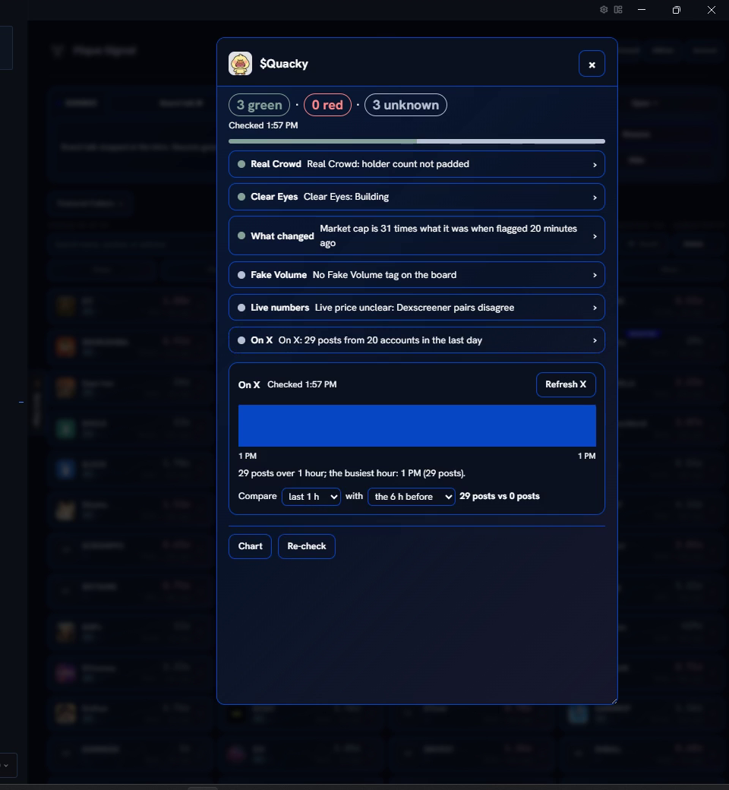
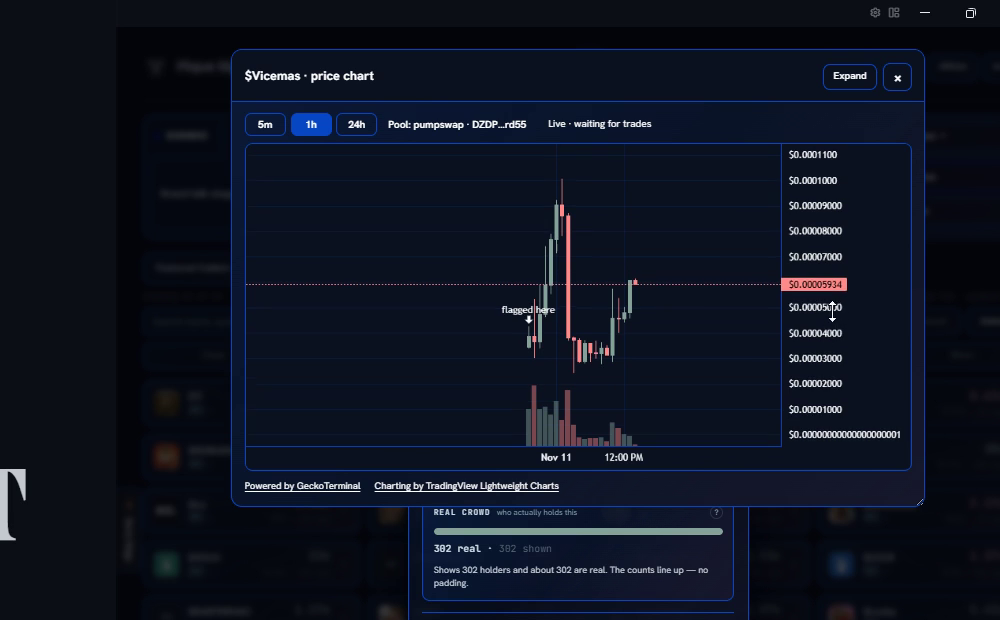

# PiqueSignal for Hermes

**Catch new Solana memecoins early, and see through the junk.**

PiqueSignal's own in-house systems find new Solana memecoins as they launch, run rug and safety checks, and flag the
junk (Fake Volume, padded crowds, rug risk). This plugin puts that live board inside Hermes Desktop and turns Hermes into a research partner
that can see it. Click a coin and Hermes knows which one you mean. Press **Deep Check** and a team of Hermes sub-agents
checks it while a card fills in on your board. Open a live price chart, or let two hosts talk you through the board out
loud. Deep Check and Board talk numbers come from the board or live data, never from the AI; On X counts the posts
Grok cites.

**Free or member:** the free board works with no key and no account; a PiqueSignal member key adds the live member
board (no delay) with Clear Eyes, Real Crowd, Early Edge and Featured Callers.

**What you need:** Hermes Desktop 0.23.0 or later with an AI model set up. The board is free. Deep Check and Board
talk run on your own AI model, so they use your own AI credits. The member plan is $49 Gated or $99 Builder at
piquesignal.xyz/unlock; nothing is bought inside Hermes. Details: [What you need and what it costs](#what-you-need-and-what-it-costs).





## Our own systems, built in-house

Everything on the board comes from systems we built and run ourselves:

- **The PiqueSignal engine** finds new Solana memecoins worth watching as they launch, and runs rug and safety checks
  before it calls a coin. Risky coins are removed or get a warning tag.
- **Fake Volume** flags coins whose trading looks faked or bundled.
- **DEX paid** tags a coin whose Dexscreener listing was paid for, usually by its team. On its own that says nothing
  about whether the coin is good or safe.
- **Rug risk and dead coins** *(member)*: the member board removes known rugs and dead coins, and Clear Eyes says Rug
  risk when the board's rug checks flag a coin.
- **Clean** *(free and member boards)*: a filter that keeps only coins that pass our safety checks.
- **Real Crowd** *(member)* compares the holder count a coin shows with the wallets that really hold it, and tags
  padded crowds.
- **Clear Eyes** *(member)* gives every called coin a plain strength read: Flagged, Early, Building, Peak, or Faded if
  it dies.
- **Early Edge** *(member)*: our list of coins picked up early.
- **Featured Callers** *(member)*: callers we back, with their newest calls.
- **A public track record** at piquesignal.xyz/track-record, so you can see how past calls did.

No check catches every rug, and nothing here is financial advice. It is research; you decide.

## Deep Check: a research team for one coin

Press **Deep Check** in a coin's pop-up or on a coin card in chat, or type "Deep Check $ABC" in a Hermes chat. Hermes
starts a team of sub-agents with its own built-in `delegate_task`, one per check, all running at the same time:

| Check | What it looks at |
|---|---|
| **Fake Volume** | Whether the board flags the coin's trading as faked |
| **What changed** | Market cap and holders now versus when the coin was called |
| **Live numbers** | The live price from Dexscreener, checked against the board; when the trading pairs disagree it says "Live price unclear" instead of showing a wrong number |
| **On X** | Real posts from the last day, found through Grok (Hermes' own `x_search`): the posts Grok cites (up to 30; shown as 30+ when it hits that cap), from how many accounts, repeat posters and the busiest 10 minutes |
| **Clear Eyes** *(member)* | Where the coin is now: Early, Building, Peak or Faded |
| **Real Crowd** *(member)* | Real holders versus the holder count the coin shows |

A card opens on your board and fills in as each helper reports back. A part that has not answered after 90 seconds
is marked not available, with Re-check (a late On X answer still fills in). Each line turns red, green or grey
(unknown); tap a line for its exact numbers, its source and its time. There is no verdict and no score:
you get the facts and you decide.

- **On X** reads like "On X: 10 posts from 7 accounts in the last day", with "3 accounts posted more than once" and,
  from 3 posts on, "6 posts within 10 minutes" in its details. An hourly timeline shows when the posts came, and two
  pickers compare the last hours with the hours before. "X check $ABC" runs only this part.
- **Saved, with Re-check:** the last check of each coin is kept for a day. **Re-check** runs a fresh one and shows what
  changed since your last look.
- **In chat,** Hermes answers with a 2-3 line version; the full card stays on the board.
- **If Hermes cannot start sub-agents,** it runs the same checks one by one and the card still fills in.
- **Only when you ask:** a Deep Check starts only when your own message asks for one (the words Deep Check or X
  check, or the panel's Deep Check / Refresh X buttons): one coin per message, a message without those words is refused, never from a
  schedule, and never inside a helper (`delegate_task`) or a chat the plugin has not seen.

The sub-agents can't make anything up. The plugin works out every number itself from the board or live data and
hands it to them (On X counts the posts Grok cites, up to 30; shown as 30+ when it hits that cap), and text from X is
never shown to any agent, so a planted post can't steer them.

## Why a plugin and not a prompt

- **Live data.** The board, Dexscreener's numbers and GeckoTerminal's candles come in live. A prompt only has what the
  model already knows.
- **Tools that act on your screen.** Hermes lights up coins, opens their cards and sets the board's filters while it
  answers.
- **Numbers the plugin computes.** Deep Check lines and Board talk numbers come from the plugin, never from the model.
  Board talk drops any model line that sounds like advice or states a fact it was not given.
- **Member data kept to your own chats.** Hermes gets the member board only in your own Hermes Desktop, terminal
  and CLI chats. A chat app such as Telegram or Discord gets the free board. A chat that another agent (Hermes Bot
  Mode), a chat app or a kanban card wrote in, a chat that sent a message to another agent, and the Bot Chat get the
  free board from then on, also after Hermes restarts (open a new chat for the member board). Hermes' own notices,
  such as a cron job's result, get the free board for that one turn. Your own chats keep the member board when you
  restart Hermes or come back to an old chat, and through pictures, voice, model switches and your own background
  jobs. A chat also gets the free board from then on when you paste another agent's Bot Mode message or a kanban
  notice into it. Text another plugin puts into a chat counts as yours when Hermes does not label it; when Hermes
  labels it, that chat gets the free board from then on. Member board facts Hermes already showed in a chat stay in
  that chat's history: start a new chat before you ask Hermes to message another agent. To keep the member board out of every chat, turn off
  **Let Hermes use my member board in chats** in Settings › Plugins › PiqueSignal (do this if a chat of yours is
  linked to a Telegram or Discord group). The board page itself always keeps your member board. If you use Bot Mode,
  agents you let message your Hermes can use its
  tools: only add agents you trust.

It is for people who follow new Solana memecoins and want the board, its warning tags and a quick second look at a
coin in the same app where they talk to their AI.

## What you need and what it costs

- **Needs:** Hermes Desktop 0.23.0 or later, with an AI model set up in Hermes.
- **Free:** the free board, pop-ups, Rewind, the price chart and the free Deep Check lines. No key and no account.
- **Uses your own credits:** Deep Check and Board talk run on your own AI model. Board talk's voice uses your credits
  only if you picked a paid voice provider in Hermes (the default Edge voice is free).
- **Optional:** a Grok (xAI) sign-in or xAI API key in Hermes for Deep Check's On X line. The search runs through
  Hermes's x_search: Hermes' x_search uses your xAI API key if one is set in Hermes (billed by xAI per search),
  otherwise your Grok sign-in. Without either, the line says the X check needs a Grok sign-in.
- **Optional:** a PiqueSignal plan for the live member board: $49 Gated or $99 Builder, 30 days at a time (subscribe
  or pay once), paid from your Solana wallet in USDC or SOL at piquesignal.xyz/unlock. Nothing is bought inside
  Hermes.

## Install

1. Run `hermes plugins install piquesignal` (once PiqueSignal is listed in the Hermes plugin catalog).
2. Run `hermes plugins enable piquesignal`, then restart Hermes. Enabling turns on the plugin's backend
   (`dashboard/plugin_api.py`), and the restart mounts its routes.
3. Switch on the Desktop half: Capabilities › Plugins (or Ctrl+K › *Desktop plugins*) › PiqueSignal.
4. Click **PiqueSignal** in the Hermes sidebar. The board opens as a full page.
5. Optional: paste your member key in Settings › Plugins › PiqueSignal (see [Member key](#member-key)).

Tested on Hermes Desktop 0.23.0 (Windows, Microsoft Store build).

**Try it in one minute:** open the board, click any coin, press **Deep Check** in its pop-up, then ask Hermes "show
me the ones like it".

**No PiqueSignal row in the sidebar?** Check that you ran the enable step, restarted Hermes and switched on
PiqueSignal in Capabilities › Plugins.

**To stop the board,** switch PiqueSignal off in Capabilities › Plugins. A morning brief you scheduled is a normal
Hermes cron job and keeps running; delete it on the Cron page.

## Free and member views

The two views are the same as on the website:

| View | Needs | What you see |
|---|---|---|
| **Free** | nothing | The free board, the same as piquesignal.xyz/free: at least 10 minutes behind live (up to 60 minutes for strong coins), with the Missed strip, the Free Pick and banners. |
| **Member (gated)** | your PiqueSignal member key | The live member board (no delay) with Clear Eyes, Real Crowd, Early Edge and Featured Callers, plus the member Deep Check lines. |

No key yet? The lock icon at the top of the free board (in the mobile view, **Unlock** in the menu) and the **Unlock
the live board** button on the gated board without a key open https://piquesignal.xyz/unlock in your browser.
Nothing is bought inside Hermes.

## Member key

The key is optional. The easy way is **Unlock with your key** in the Hermes box (Open ▾ › Ask; also on the gated
board without a key): *Get my key* opens your Account page in the browser (then open its API key tab), *Open the key box* opens Hermes's own Settings
page of the plugin where you paste the key and press Save, and *Check my key* says "Key works - gated board unlocked" or
what is wrong. The second way: Settings › Plugins › PiqueSignal › *PiqueSignal member key* (the gear on the PiqueSignal
row in Capabilities › Plugins). Either way it is stored as a Hermes secret (`PIQUESIGNAL_API_KEY`) by Hermes itself and
read only through Hermes's secret store; the board never takes, displays or keeps it (Hermes 0.23.0 has no plugin call
that saves a secret, so the board cannot remove it either; paste a new key the same way to change it).

## What it sends, in short

| Service | What is sent | When | Key |
|---|---|---|---|
| piquesignal.xyz | Requests for the boards and their parts, from the plugin's backend | Paced: the free board at most every 30 s, the member board at most once a minute | Your member key, only on member requests |
| cdn.dexscreener.com | Requests for coin pictures | When cards and pop-ups show a coin | None |
| api.dexscreener.com | The coin's public contract address | Only when you run a Deep Check or open a price chart | None |
| api.geckoterminal.com | One pool address | Only when you open a price chart or switch its time frame, and while an open chart is visible (live trades) | None |
| xAI (Grok), through Hermes's x_search | The coin's contract address | Deep Check's On X line, one search per Deep Check | Your xAI sign-in or API key, held by Hermes |
| Your AI model and voice provider (set in Hermes) | Board facts (Board talk sends no coin addresses); Board talk's words go to the voice provider | When Hermes uses the tools, when you chat about a coin you picked, Deep Check, Board talk | Your own Hermes setup |

No telemetry. Every limit is in [What it does on the network](#what-it-does-on-the-network-disclosure),
[What reaches your AI model](#what-reaches-your-ai-model) and [What it stores](#what-it-stores) below.

## Features

**The board**

- **Full page:** a **PiqueSignal** row in the Hermes sidebar opens the board as a full page. It is the desktop
  website board: the same cards, tags, filters, search, saved coins, buy picker and coin pop-up.
- **Side pane:** the board next to your chat (the website's mobile view when you make the pane narrow), with the same cards, tags, filters, search and saved coins. Open
  it from the command palette: **PiqueSignal: open the board beside the chat**.
- **Filters:** both boards have the website's filter chips. Three website filters (Caller, Flash point and Signals)
  are left out of Hermes.
- **Status bar:** a small count of the coins on the board. Click it to open the board.
- **Missed strip, Free Pick and banners (free board) and Featured Callers (member board):** the same parts as on the
  website. The Missed strip ("Paid gets it first") shows paid calls that went up, by gain only; with a member key a
  click on a tile opens that coin on the member board. The Free Pick shows the free board's live pick with its
  countdown. Banners are marked "Ad". Featured Callers (member key) lists the callers' newest calls; a call opens its
  details (Copy, Dexscreener, Solscan, pump.fun and **Open on board**, which opens that coin on the member board), and
  a caller with a valid Telegram channel name gets a **Telegram** button. Member parts need a valid member key; if a
  part cannot load, the plugin hides it and the rest of the board works as usual.
- **Early Edge** (member board, on the full page and in the side pane at its normal width): the website's Early
  Edge panel of coins picked up early, with its switch and its "Tune what you see" choices. In the mobile view (the
  side pane dragged narrow), **Early Edge** in the menu opens the website in your browser.
- **Price chart:** a coin's price chart (its **Chart** button in the coin pop-up or in the Deep Check card) with
  5m, 1h and 24h candles (24h = UTC days), drawn with TradingView Lightweight Charts™, with a crosshair, zoom and
  scroll, and a "flagged here" marker on the candle where the coin was called. It loads only when you open it
  or switch its time frame. The candles come from GeckoTerminal ("Powered by GeckoTerminal" is shown on the chart) for the
  one pair Deep Check's live pair rule picks on Dexscreener (the pair is named on the chart: its exchange and a short
  pool address). When Dexscreener's pairs disagree, or the candles' last price is more than 5 times from that pair's
  live price, there is no chart. **Live trades:** while a chart is open and visible, it asks GeckoTerminal for that pool's
  latest trades at most every 10 seconds; it pauses when hidden and stops when closed, after 15 minutes without a
  click or key press in the chart, and 20 minutes after the chart last loaded (a click resumes it). New trades update the last candle (or start the next one) and the chart shows "Live · updated" with the time.
  **Expand** opens the same chart as a full page, with the same controls; **Back** returns to the board.
- **Deep Check:** the **Deep Check** button in every coin pop-up and on Hermes's chat coin cards, or "Deep Check $ABC"
  in a Hermes chat. See [Deep Check](#deep-check-a-research-team-for-one-coin) above.

**Talking with Hermes**

- **Point and Talk:** click a coin card and Hermes knows which coin "this one" is (Hermes Desktop and terminal chats; the status bar
  shows **Hermes sees $COIN ×**, click it to stop sharing). Ask Hermes to "show me the ones like it" or "walk me
  through the board": it lights up and opens cards on the board while it talks. It can also set the board's filters
  and search from a sentence ("only DEX paid coins up 2x+").
- **Ask Hermes:** every coin pop-up has an **Ask Hermes** button. It sends a short question about the coin to your
  Hermes chat. If it cannot send, it puts the question in your chat box and you press Enter.
- **Coin cards in chat:** in Hermes Desktop, while the board is open, Hermes adds a coin's card to its reply when it
  names a coin from your board, drawn from the board data already on your screen.
- **Answers that read well aloud:** Hermes gets the board's numbers in words ("1.2 million dollars"), so a reply that
  is read aloud sounds right. It writes a contract address only when you ask for it, inside a code block you can copy,
  which is never read aloud.
- **What a tag means:** just ask in the chat, for example "What does Fake Volume mean?". Hermes answers with
  PiqueSignal's own explanations of Fake Volume, DEX paid, Clear Eyes, Real Crowd and the other board words. This is
  a chat question, not a button.
- **Hermes box:** above the board, one closed line: **Board talk ▶**, **Voice chat**, **Rewind: Live** and **Open ▾**.
  **Rewind** shows a short Rewind row under the line (the slider, the time and **Live**; press Rewind again, Live or Esc
  to hide it); it does not open the box. **Open ▾** shows 4 parts: Ask, Listen, Rewind and Alerts. The full page and the side pane each remember if their box
  is open or closed (it starts closed).
- **How it works:** this Hermes box button asks Hermes to walk you through PiqueSignal part by part, in short plain
  words, and then ask what you want to know more about. Hermes answers only from the plugin's packaged guide
  (`guide.md`, through the `piquesignal_guide` tool).
- **Board talk:** the **Board talk ▶** button in the Hermes box makes a short radio-style talk about your board, with
  two hosts taking turns: the biggest movers since they were flagged, new arrivals, tags that just came on, and your
  saved coins, each told from the board's own numbers. While it plays, a player takes the place of the box's line: who
  is speaking, the segment, one dot per coin, big captions and Back / Pause / Skip / More / Ask / Stop (*More* and
  *Ask* pause it and send the coin on air to your Hermes chat); the board lights up and opens each coin as it is talked
  about. Nothing plays by itself, and **Stop** stops it. **Resume** then goes on from that coin (it replays the same
  stored Board talk). Only one Board talk is made at a time, and each new one uses your own AI
  model and voice. **Replay** plays your last Board talk again (no new Board talk, no model call). Each spoken line
  passes briefly through a temporary file that is deleted as soon as the line is read (a crash can leave one in the
  system temp folder); the voice already made for a Board talk is then kept in memory only, for Back, and is gone when it stops. An
  optional morning Board talk (off by default) gets one ready at the time you choose while Hermes Desktop is open. The
  palette command *PiqueSignal: Board talk voice test* checks that your voice works.
- **Voice chat with Hermes:** **Voice chat** turns on Hermes's own voice chat (the same as its mic button or Ctrl+Alt+V), so you
  can ask about your board by voice. Board talk pauses and cannot play while the voice chat is on (the mic would hear
  the hosts). If voice chat does not start, the box says so; press **Mic blocked?** there for the steps to allow the
  mic in Windows. To hear an answer, hover it in the chat
  and press the speaker, or turn on *Read replies aloud* in Hermes's voice controls.
- **Unlock with your key:** three short steps in the Hermes box to get, paste and check your member key (see
  [Member key](#member-key)).
- **Chat apps:** Hermes can use the board tools in Telegram, Discord and the other chat apps it runs in. There it gets
  the free board, and Deep Check sends only its short version.

**Keeping up**

- **Rewind** (on by default; switch it off in Settings › Plugins › PiqueSignal): a slider above the board shows the
  board as it was earlier (snapshots every 10 minutes while the board
  is open, kept up to a day on this computer; after a gap, the board's last 24 h from piquesignal.xyz fills it in).
  After a break, a **Since you looked away** line sums up new calls, changed tags and coins that left; **Ask Hermes**
  sends a catch-up question to your Hermes chat (if it cannot send, it puts the question in your chat box and you
  press Enter).
- **Pop-ups for new calls:** a Hermes notice when a new coin lands on the board. You get a system notification when
  Hermes is in the background. Turn them off in Settings › Plugins › PiqueSignal.
- **Saved-coin alerts:** a pop-up when a coin you saved (the star) gets or loses a tag, changes its Clear Eyes step
  or leaves the board. Here too you get a system notification when Hermes is in the background.
- **Morning brief:** a ready-made daily job (a Cron blueprint) on the Hermes **Cron** page (*PiqueSignal morning brief*): pick a time and
  the board, and Hermes writes a short summary of the newest calls, the biggest moves and any Fake Volume tags. The
  *Morning brief* button in the Hermes box is not this job: it asks Hermes for a summary of the board right now.

*Not financial advice. On-chain data, for research only. Memecoins are very risky. PiqueSignal and its operators may
hold or trade coins shown on the board. Nothing trades or touches a wallet.*

## What it does on the network (disclosure)

- **piquesignal.xyz**, from the plugin's backend only (the screens never call it):
  - `GET /api/free-board`: the free board. No key. At most once every 30 seconds.
  - also with no key, the free board's own parts (asked only while a free board is open): `GET /api/free-board/missed`
    (the Missed strip: gains only, never a coin name or address) and `GET /api/free-board/free-pick` (the Free Pick),
    each at most once every 30 seconds; `GET /api/free-board/banners` (the banners marked "Ad"), at most once every
    5 minutes; `GET /api/free-board/img/<key>` (only the pictures those Missed and banner answers name, at most 2
    every 10 seconds; a coin logo is kept 10 minutes, a banner picture 24 hours); and `GET /api/free-board/history`
    (the free board's last 24 h, for Rewind; see below).
  - with a member key: `GET /api/pull/feed` (the member board), `GET /api/pull/me` (your key's daily limit, at
    most hourly), `GET /api/pull/early-edge`, `GET /api/pull/featured-callers` (Featured Callers, while the member
    board is open: at most once every 15 minutes, hourly until your key's daily limit is known), `GET /api/pull/history`
    (the member board's last 24 h, for Rewind; see below) and `GET /api/pull/missed-reveal/<id>` (the coin behind a
    Missed tile: only when you click the tile, at most one every 10 seconds, each answer kept 30 minutes, at most 50 a
    day and at most 10 % of your key's daily limit). All of them together are paced to use at most 60 % of your key's
    daily limit (the reveals' own daily cap is counted inside it), the member board never more than once a minute. The
    pacing is counted per Hermes process: another Hermes program that loads the plugin with the same key (for example
    a separate `hermes` terminal session) paces itself on its own, so two of them together can use up to twice that
    share, which can use up your key's daily limit. The key goes only in the `Authorization` header of these requests,
    never to the no-key addresses.
  - The 24 h history (both views, only while Rewind is on in Settings): a history address is asked only when the
    newest Rewind snapshot of that board is more than 15 minutes old (or there is none), at most once every 20 minutes
    (3 an hour; the server allows 4), one request at a time; an answer is capped at 3.2 MB. The member history is
    asked only while your key works and is kept only for that same key.
  - Every request has a back-off. It follows `Retry-After` (at most 1 hour), slows down after errors, and stops for 15
    minutes (plus a little random extra) after a rejected key or any other refused request. If only Early Edge or
    Featured Callers is refused for your key, only that part is hidden; it is asked again after that wait.
  - The Missed strip, Free Pick, banners, Featured Callers and both history addresses wait a random 0 to 120 seconds
    before their first request after Hermes starts (Missed reveals and pictures have no such wait: they are asked only
    when needed). On these addresses a refused request (any 4xx but 429) stops that part for about 15 minutes (plus a
    little random extra) and hides it; a 404 on a history address stops it until Hermes restarts. A 429 or 503 keeps
    the last good answer (history: the local Rewind), with no error message and no faster retry. They never carry a
    query string. Answers are capped: history 3.2 MB, a coin logo 64 KB, a banner picture 2 MB, everything else 2 MB;
    a picture must be PNG, JPEG or WebP.
- **cdn.dexscreener.com**: coin pictures on the cards, the same as on the website. For a pop-up (a new call or a saved
  coin that changed), the backend also fetches that coin's picture from there (no key, no cookie) and keeps it (see
  *What it stores*).
- **api.dexscreener.com** (Deep Check and the price chart only): whenever Deep Check runs (button, chat, or a chat app), this PC sends the
  coin's public contract address to api.dexscreener.com; that site sees your IP address; no key, no other data. One
  request per Deep Check of one coin, only when you ask for it (never in the background): `GET
  /token-pairs/v1/solana/<contract address>`, with a plain User-Agent that does not name the plugin, no cookie and no
  query string; https only, no redirects, at most 256 KB; it gives up after 5 seconds without an answer at any network
  step and reads the answer for at most 15 seconds after asking (a very slow server can stretch the whole read to about
  half a minute); the same coin is asked at most once a minute (the last answer is reused), at most 2 at a time and 2
  seconds apart (a read asked sooner is not made: the line says "Live numbers not available"); a 429 or 503 stops these
  reads quietly for the time Dexscreener asks (at most 15 minutes), any other refusal stops that coin for 15 minutes.
  Only numbers of that coin's own Solana pairs priced in SOL or USDC (and the name of the exchange of the pair used)
  are kept; every other text in the answer is dropped. The pair used is the one with the most trading in the last hour
  (never just the one with the most liquidity); when the pairs' prices are more than 5 times apart, or that pair traded
  under $1,000 in the last hour, the line says "Live price unclear: Dexscreener pairs disagree" and shows no number.
  Opening a price chart (coin pop-up or Deep Check card) or switching its time frame makes this same read, with the same limits and the
  same one-minute answer, to find that pair.
- **api.geckoterminal.com** (the price chart only): only when you open a price chart (coin pop-up or Deep Check card) or switch its time
  frame (the candles: never on a timer, never in the background, one coin at a time; an open chart's live trades are
  below), this PC sends the address of the one pair
  the live pair rule above picked (a pool address, nothing else) to GeckoTerminal's public API, with no key:
  `GET /api/v2/networks/solana/pools/<pool address>/ohlcv/<minute|hour|day>` with fixed `aggregate`, `limit`
  and `currency=usd` values; that site sees your IP address; no key, no cookie, no other data. A plain User-Agent that
  does not name the plugin; https only, no redirects, at most 512 KB, 5 seconds without an answer at any network
  step and 15 seconds of reading; the same pair and time frame at most once a minute (the last answer is reused), at
  most 2 at a time; a 429 or 503 stops these reads quietly for the time GeckoTerminal asks (at most 15 minutes), any
  other refusal stops that pair for 15 minutes. Only the candles are kept (time, open, high, low, close, volume, each
  checked as a finite number); every other part of the answer is dropped. When the pairs disagree ("Live price
  unclear") or no pair is found, nothing is sent to GeckoTerminal and there is no chart. When the candles' last price is
  more than 5 times from that pair's live price (GeckoTerminal may list a pool the other way round), they are dropped and
  there is no chart either ("Live price unclear"). On the member board this lets
  Dexscreener and GeckoTerminal see which coin's chart was opened.
  **Live trades:** while a chart is open and visible, it asks GeckoTerminal for that pool's latest trades at most every 10
  seconds; it pauses when hidden and stops when closed or after 15 minutes without a click or key press in the chart, and
  20 minutes after the chart last loaded (a click resumes it: the chart loads again first, as when you open it):
  `GET /api/v2/networks/solana/pools/<pool address>/trades` (no query), only for the pool that chart already
  picked (no Dexscreener read, nothing when the price is unclear), one coin at a time; the same plain User-Agent, no
  key, no cookie, https only, no redirects, at most 512 KB and 15 seconds of reading; at most one request every 10
  seconds in all (the last answer is reused); a 429 or 503 waits 10 seconds, doubling up to 2 minutes (the chart then
  says "Live updates paused"), any other refusal stops that pool for 15 minutes. Only each trade's time, buy or sell,
  the coin's price, the USD volume and the trade id are kept (at most 300, in memory only).
- **xAI (Grok), through Hermes' own x_search** (Deep Check's On X part only): the X check sends the same contract address
  to xAI (Grok) through Hermes' own x_search (nothing else: not the coin's name,
  not your member key). Hermes' x_search uses your xAI API key if one is set in Hermes (billed by xAI per search),
  otherwise your Grok sign-in. One search per Deep Check, one at a time, in the background; after 150 seconds the
  plugin stops waiting and drops a later answer (the search itself may still be running in Hermes: until it has
  really ended, a new X check says "X check already running", which can take up to Hermes' own x_search time limit
  for each of its tries, about 9 minutes with Hermes' defaults; after 15 minutes the next X check starts anyway).
  Only the links of the X posts Grok cites are read (the account name from the link, the post time from the link's
  number); Grok's written answer is never read or shown. With no Grok sign-in, Hermes' x_search refuses and the line
  says so (unless an xAI API key is set).
- On the member board this lets those services see which coin was checked.
- **Links you click** open in your browser, never inside Hermes: piquesignal.xyz pages, dexscreener.com, solscan.io,
  x.com, t.me (also a Featured caller's Telegram channel), pump.fun (a Featured call's coin page), tradingview.com and
  geckoterminal.com (the chart's credit links), a coin's own website, the trading site you choose in the buy picker (Axiom, Photon, BullX, GMGN,
  Pump.fun, Jupiter or Phantom) and the link of a banner (marked "Ad", https only). The plugin sends no banner view or
  click counts. Featured Callers names and call notes are shown as plain text (links inside them are not clickable);
  their link buttons are built only from the coin's contract address and the caller's Telegram name, and **Open on
  board** opens that coin on the member board inside Hermes.
- **No telemetry.** The website's analytics and tracking are not part of the plugin.
- Hermes's tools, the coin you pick and the morning brief use the same backend and the same paced requests above to
  piquesignal.xyz: they add no address there and, within one Hermes process, never make requests more often than the
  panel itself. The one exception is `piquesignal_deep_check`: a Deep Check you ask for also makes the Dexscreener
  request and the X search above (at most one of each per Deep Check). It is refused from a scheduled job (cron, the
  morning brief) and from a Hermes helper. A Deep Check starts only when your own message asks for one (the words
  Deep Check or X check, or the panel's Deep Check / Refresh X buttons): one coin per message, a message without those words is refused,
  never from a schedule, and never inside a helper (`delegate_task`) or a chat the plugin has not seen. For all chats
  together, at most one starts every 5 seconds and 30 an hour.
- **Your voice provider (Board talk):** only when you press Board talk (or turn on the morning Board talk) or run the
  voice test, the words of the Board talk, including the board numbers it reads out, go to the text-to-speech provider
  set in Hermes (Settings › Voice). By default that is Microsoft Edge TTS (free), spoken with two Edge voices through the
  `edge_tts` library Hermes itself uses. Any other provider speaks with one voice through Hermes's internal
  `tools.tts_tool` (a private import: it may need an update when Hermes changes). A paid provider uses your own
  credits. The voice test speaks one fixed line, at most 30 times a day.
- **Voice chat with Hermes:** nothing new is sent by PiqueSignal. Voice chat only turns on Hermes's own voice chat. Your voice is
  handled by that voice chat and goes to the speech-to-text set in Hermes (Settings › Voice), which may be an online
  service unless you pick a local one there (if you picked a live voice model in Hermes, your voice goes to that service,
  so for GPT-Live it goes to OpenAI, paid with your own OpenAI key); spoken replies use Hermes's own voice. PiqueSignal never opens
  the mic, never records and never reads what you say or type.

## What reaches your AI model

Hermes runs on the AI model you set up. When Hermes uses this plugin's tools, or when you have picked a coin on the
board and chat in Hermes Desktop, it receives **board facts only**: the coin's symbol, name and contract address and
the numbers and tags the board shows. With a member key that includes the member view's Clear Eyes step, its Clear
Eyes note and the Real Crowd line, so those member facts then go to your model provider.

Hermes can use these tools in any chat it runs, including chat apps like Telegram, Discord or Slack, and the answer
then goes to that chat. The member view is given only in Hermes Desktop,
terminal (TUI) and CLI chats and in a run of the *PiqueSignal morning brief* that Hermes' own scheduler fires and whose reply stays in Hermes
(a run with words added for that run, or a brief job with any extra setting: a skill, script, monitor, work folder,
job notes, another job's output, a copy of its delivery into a chat, a failure delivery to a chat app, or its own model
endpoint, gets the free view; so does a brief that another cron job is set to read, and a cron job set to read the
brief later still sends the brief's saved output wherever that job delivers). Everywhere
else (a chat app, another cron job, or a chat whose platform cannot be told) the board tool gives the free view, with
a short note that the member view is local only. `piquesignal_point` and `piquesignal_filters` act on the board open
in Hermes Desktop: from such a chat, pointing at the member board or setting its filters and search is refused.

The Missed strip, Free Pick, banners, Featured Callers and the server's 24 h history are shown on the board only: the
tools and hooks do not read them. A "while you were away" line built from the history reaches your model only when you
press its **Ask Hermes**, like any other "since you looked away" line. The price chart is shown on the board only:
no model sees its candles.

The picked-coin line is added only in Hermes Desktop and terminal (TUI) chats (not Telegram, Discord or
other chat apps) and only while the board is open. Turn it off in Settings › Plugins › PiqueSignal. Coin names come
from coin creators, so they are passed to the model as data, not instructions (a symbol is cut to one short word and a
name to 32 characters).

**Board talk:** when you press Board talk (or turn on the morning Board talk), Hermes's own model gets one short request
per new Board talk (one Board talk is made at a time, and each one uses your own model's credits). For
the coins it writes about (up to 8) it gets only: the coin tickers, tags, how long each coin
has been on the board, which coins you saved, which part of the Board talk each coin is in (biggest movers, new arrivals
or your coins) and which board (free or member), what changed (new calls, tags on or off), and the board's own numbers
as fill-in tokens: change since flagged, market cap now and when flagged, holders, and holder counts from earlier in
the same Hermes session (kept in memory only). It also gets the board's counts (coins on the board, new calls, coins
that left the board, and the minutes since you looked away or since the earlier board). On the member board it also
gets the status words (Flagged, Early, Building, Peak, Faded) with the earlier step, the Padded crowd tag and the Real
Crowd real and shown counts (now and earlier).
No coin addresses, scores, wallets or keys are sent. The model never writes a number itself: the plugin puts in the
board's own value. Coins under *Watch out* (Fake Volume or Padded crowd just came on) and coins whose name is an
advice or hype word always get the plugin's fixed lines, and every Fake Volume or Padded crowd tag is said by a fixed
warning line. Every other line is checked: a line that sounds like advice, judgement, hype, price talk or a
prediction, mentions how the board works, puts a number in the wrong place or states a fact that was not sent is
dropped or replaced by fixed lines for that coin (if no line passes, the whole Board talk uses the fixed script).
Replay speaks the same stored, checked Board talk again without asking the model, and a member Board talk is only
spoken or replayed with the member key it was made with.

**Deep Check:** your own AI model runs it (Hermes's own helpers through its `delegate_task`, or the chat itself one
check at a time), so it uses your own model's credits. The helpers get a run id, the part name and the contract
address, and read back that part's fixed line (on a member check, the member lines too; Hermes may run helpers on the
model set for delegation). Your chat model also gets the coin's ticker (as data, from the Deep Check button's
message), which view it is, the plugin's own fixed lines for each check (built from the board's facts and the numbers
read from Dexscreener and X) and a 2-3 line summary in words. Dexscreener's answer and the X posts are never passed to
any model: the plugin reads only their numbers, and only the links of the posts Grok cites. In a chat app the Deep
Check is the free one and only the summary goes to that chat; the full card is shown only in Hermes Desktop.

In Hermes Desktop, while the board is open, and only when you picked a coin or your message is about the board (it
names PiqueSignal, the board, coins or a board word, or a ticker or contract address on your board), Hermes is also
asked to add a coin card to its reply when it names a coin from your board, and to write a backslash before the `$` of
a ticker or an amount (code is written as normal). Replies may be read aloud, so Hermes is asked to write a contract
address only when you ask for it, and then only inside a fenced ``` code block (shown and copyable, never read aloud),
never in normal text or inline code. This rule is in the plugin's tool texts too, so it holds in every chat (Desktop,
Telegram, Discord ...). The plugin draws that card only from the board data already on your
screen. The Hermes buttons on the board (*Ask about*, *How it works*, *Morning brief*, *Ask Hermes*, and *More* and
*Ask* in the Board talk player) send a question into your Hermes chat only when you click them. With *Voice chat*,
what you say becomes a normal chat message to your own model, the same as typing it.

## What it stores

- One optional secret: your member key (Hermes secret store).
- In Hermes's plugin storage: saved coins, the chosen buy site, Free or Gated, the member board's Early Edge panel
  choices (on or off, its filters, which parts are open, the items you hid), the settings (incl. the morning Board
  talk time), whether the Hermes box is open on each board (`hermesOpen`), the result of the last voice test
  (`liveVoiceTest`: worked or not, how long, when) and the day of the last morning Board talk try (`liveMorningDay`).
  (An older version also kept `talkNote` and `liveConsent` there, for one-time Voice chat and Board talk notes that are
  gone now; they are no longer read or written.)
- In the plugin's own Desktop data folder: the Rewind history, one file per view (`rewind-free.json`,
  `rewind-gated.json`), the rows the board already showed you and, after a gap, the board's last 24 h as the server
  sends it (merged into the same file; free: only coins that are on the free board now; member: only for the same
  key), up to a day and under 4 MB each. The member file is tied to your key and erased when the key is removed,
  changed or refused. Switching Rewind off erases both.
- The last Deep Check per coin (up to 20 coins, 24 h) is kept in the Desktop data folder (deepcheck-free.json,
  deepcheck-gated.json); the member file is erased when the key is removed, changed or refused; nothing is uploaded.
  It holds each checked coin's contract address and ticker, the card's lines, numbers and times, and for On X the
  account names, post times and public post ids (also from your earlier checks of that coin, up to 120, so the timeline continues).
  The member file is tagged with your key's one-way id (never the key).
- In memory only (gone when Hermes stops): the Missed and banner pictures (up to 16 MB), the Missed reveal answers
  (30 minutes each), the running Deep Checks (up to 20, 15 minutes each; a member one ends when the key is removed,
  changed or refused), the last Dexscreener answer per coin (1 minute), the last GeckoTerminal candles per pair and
  time frame (1 minute), the pool the chart picked for each opened coin (up to 50, an hour after the chart last
  loaded) and the last live trades answer per pool (up to 20).
- In Hermes's plugin data folder (`plugin-data/piquesignal/`):
  - `panel.json`: which view the board shows and the coin you picked (an address and a time; no key, no board data);
  - `coin-icons/`: the pictures of up to 40 coins from pop-ups (file name = the coin's contract address), with a
    small owner file (`free` or your key's one-way id, never the key). After the member key is removed, changed or
    refused, they are all deleted the next time the board checks the key. Pictures saved with no member key are
    kept (up to 40);
  - `live-test-count.json`: the day and the number of voice tests that day (for the 30-a-day limit).
- A morning brief you schedule is a normal Hermes cron job: it keeps running if you disable the plugin; delete it on
  the Cron page.
- Nothing else is stored. Nothing is kept in Hermes's plugin state (a Board talk counter an older version kept there,
  `live.caps`, is no longer read or written).
- No shell commands and no separate processes. The backend runs inside Hermes's own server. The only background work
  is a Deep Check's X search: one worker thread per X check plus the x_search call itself, inside Hermes. The plugin
  stops waiting after 150 s and drops a late answer; until the earlier x_search call has really ended (up to Hermes'
  own x_search time limit for each of its tries, about 9 minutes with Hermes' defaults; at most 15 minutes), a new X check says
  "X check already running".

## How it is built

- `desktop/plugin.js`: the screens. They run the website's own board code inside a sealed scope. That code gets
  coin rows (and the Missed strip, Free Pick and Featured Callers) only from this plugin's backend. Every other
  website call is answered locally with "not found", so the screens make no network calls of their own (except coin
  pictures; Missed and banner pictures come from the backend as `data:` images). Links are routed to your browser. Coin values
  are always set as text. There is no `eval`, no injected script and no remote code.
  The file is assembled by the repository's `gen/` scripts from the PiqueSignal website board pages (see `gen/README.md`);
  the full page copies stay private and are not part of this repository.
- `dashboard/plugin_api.py`: the backend routes (`/status`, `/board?view=free|gated`, `/early-edge`, `/panel`,
  where the board reports its view and your picked coin, `/coin-icon` for a pop-up's coin picture, `/chart` for a
  price chart (on your click only), `/chart/trades` for its live trades (only while it is open and visible), `/missed`,
  `/free-pick`, `/banners`, `/featured`, `/img`, `/reveal` and `/history` for the Missed strip, Free Pick, banners,
  Featured Callers, their pictures, Missed reveals and the 24 h history, and the Board talk routes `/live/speak-test`, `/live/caps`,
  `/live/episode`, `/live/episode/replay`, `/live/episode/audio` and `/live/episode/stop`).
- `core.py`: the shared Python part (one copy per Hermes process): the paced feed clients, the picked coin, the
  pop-up coin pictures, the board facts in spoken words, the tag explanations and Deep Check (its fixed lines, the
  Dexscreener read and the X search threads) and the price chart's candles and live trades (the GeckoTerminal reads).
- `feed_client.py`: one polite HTTPS client for the feeds. It uses fixed piquesignal.xyz URLs, follows no
  redirects, caps answers (2 MB; history 3.2 MB; pictures above), has a hard time limit and does the back-off above.
- `rowclean.py` and `gatedclean.py`: every coin row (also every history row) is rebuilt from a fixed list of allowed
  fields, with strict types, before the screens see it. `freepickclean.py` does the same for the Missed strip, Free
  Pick and banners answers.
- `__init__.py`: the agent half. Tools `piquesignal_board` (read the board), `piquesignal_point` (light up / open
  cards), `piquesignal_filters` (set filters and search), `piquesignal_explain_tag`, `piquesignal_guide` (the packaged
  how-it-works guide, `guide.md`), `piquesignal_deep_check` (Deep Check of one coin: start, part, summary; the
  plugin builds every line); the `pre_llm_call` hook (the
  picked-coin line and the coin-card note above; no network; it also reads the whole chat for signs that someone else
  wrote in it, and the first time it meets a chat it reads that chat's stored history in Hermes' own session database
  once, read only, on this PC; a chat someone else wrote in is kept as a one-way id in the plugin's Hermes state file
  `plugin-data/.../state.json`, no chat text); the `transform_llm_output` hook (on the Desktop, puts a
  backslash before each `$` of a PiqueSignal reply so coin tickers and dollar amounts are not drawn as maths; code is
  left as it is; it does nothing when another plugin also rewrites replies, or when it cannot tell (it reads a private
  Hermes list that may change in a Hermes update), so that plugin's rewrite, e.g. hiding secrets, is never dropped); the
  `post_compaction` hook (when Hermes compacts a chat and gives it a new id, the plugin's own marks for that chat
  follow it, also in the state file; no network, the chat is not changed); the `pre_tool_call` hook (when a chat sends a message to another
  agent with Hermes' message_agent, that chat gets the free board from then on; it never blocks or changes a tool
  call); the *PiqueSignal morning brief*
  blueprint. Nothing trades, signs or touches a wallet.

## Support

Made by PiqueSignal (Top Tier Strategies LLC). Questions or bugs: piquesignal@gmail.com.

## Licence

The three fonts embedded in `desktop/plugin.js` (Hanken Grotesk, JetBrains Mono, Bricolage Grotesque) are open-source
fonts under the SIL Open Font License 1.1; their licence texts are in `fonts/`. They are not part of the licence below.

The price chart is drawn with TradingView Lightweight Charts™, bundled in `desktop/plugin.js` under the Apache
License 2.0 (with its fancy-canvas part, MIT). It is not part of the licence below. Notice: "TradingView Lightweight
Charts™ Copyright (c) TradingView, Inc." (https://www.tradingview.com/). The licence texts are in `licenses/`
(`licenses/lightweight-charts-LICENSE.txt` and `licenses/fancy-canvas-LICENSE.txt`).

The chart's data comes from GeckoTerminal's public API, a CoinGecko product ("Powered by GeckoTerminal",
https://www.geckoterminal.com/). The data belongs to GeckoTerminal; this plugin gives no rights to it.

All rights reserved. You may install and use the plugin unchanged as a Hermes plugin, and read its source to review it: every file the plugin runs is in this repository, so anyone can check exactly what it does.
Copying, changing or reusing any part of it (including the PiqueSignal board code it carries) needs written permission. See `LICENSE`.
